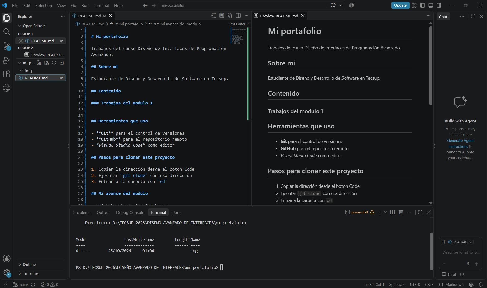

# Guía del proyecto: Mi portafolio

Esta guía documenta el proyecto de portafolio desarrollado para el curso de Diseño de Interfaces de Programación Avanzado. Explica su estructura, las herramientas utilizadas y cómo consultar sus archivos.

## 1. Descripción del proyecto

El proyecto reúne documentación en Markdown y una captura de pantalla para presentar el trabajo realizado durante el curso.

### Objetivo

Organizar los archivos del proyecto y facilitar que otros estudiantes comprendan su contenido y puedan consultarlo desde GitHub.


## 2. Herramientas utilizadas

- **Visual Studio Code:** editor para crear y modificar archivos.
- **Git:** herramienta para registrar los cambios del proyecto.
- **GitHub:** plataforma para publicar el repositorio.
- *Markdown:* formato utilizado para organizar la documentación.

## 3. Pasos para consultar el proyecto

1. Ingresar al repositorio de GitHub.
2. Abrir el archivo `README.md` para revisar la presentación general.
3. Entrar en la carpeta `docs` y abrir `GUIA.md`.
4. Consultar los enlaces y la imagen incluidos en la documentación.

### Lista de tareas completadas

- [x] Crear el repositorio del proyecto.
- [x] Crear el archivo README.md.
- [x] Agregar la captura en la carpeta img.
- [ ] Revisar y actualizar la documentación.


## 4. Comandos principales

La siguiente tabla resume tres comandos utilizados para administrar el proyecto.

| Comando | Función | Ejemplo de uso |
|---|---|---|
| `git status` | Consultar el estado de los archivos. | `git status` |
| `git add` | Preparar los cambios para guardarlos. | `git add .` |
| `git push` | Publicar los cambios en GitHub. | `git push origin main` |

### Ejemplo de comandos

```bash
git status
git add .
git commit -m "Actualiza la guia"
git push origin main
```

> La documentación clara facilita que otros estudiantes comprendan y mantengan el proyecto.


## 5. Recursos del proyecto

Para aprender más sobre Git, consulta la [documentación oficial de Git](https://git-scm.com/doc).

La captura siguiente muestra el proyecto en Visual Studio Code.

